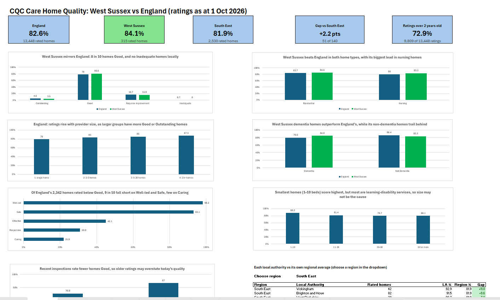
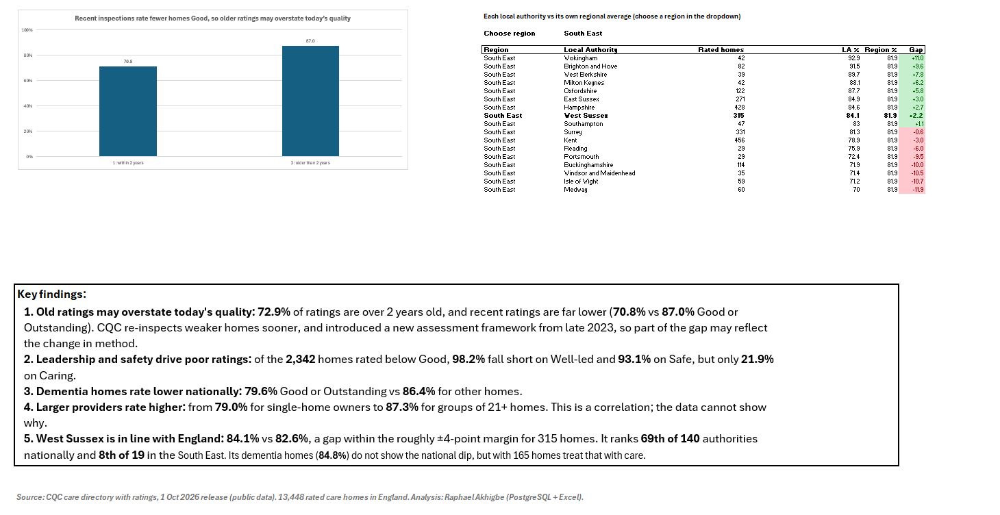

# CQC Care Home Quality: West Sussex vs England

**Tools:** PostgreSQL 18 · pgAdmin 4 · Excel (Power Query, XLOOKUP, FILTER) · **Data:** public CQC data, 1 Oct 2026 release

## The business question

Families, councils and NHS commissioners all ask the same thing: *is care-home quality in our area as good as elsewhere, and what do the better homes have in common?*

This project answers it for **West Sussex**, comparing its care homes with **England** and the **South East** on CQC inspection ratings, and looking at the factors that go with better ratings.

## Key findings

1. **West Sussex: 84.1%** of rated homes are Good or Outstanding, slightly above England (**82.6%**) and the South East (**81.9%**). The gap with England is about 5 homes out of 315.
2. West Sussex is **+2.2 points** above the South East average, **51st of 140** authorities when each is compared with its own region.
3. Nationally, homes run by **larger providers rate higher**: 79.0% for single-home owners rising to 87.3% for groups of 21+ homes. West Sussex **dementia homes (84.8%)** beat England's dementia homes (79.6%).
4. Of the **2,342** homes rated below Good, over 9 in 10 fall short on **Well-led (98.2%)** and **Safe (93.1%)**, but only about 1 in 5 on **Caring (21.9%)**.
5. **Caution:** **72.9%** of ratings are over 2 years old, and recent inspections rate fewer homes Good (**70.8%** vs **87.0%**), so older ratings may overstate today's quality.

## Data

| Source file (CQC "Using CQC data" page) | Used for |
|---|---|
| Care directory with ratings (`01_October_2026_Latest_ratings.ods`) | Overall and key-question ratings, publication dates |
| Care directory with filters (`01_October_2026_HSCA_Active_Locations.ods`) | Location details: region, local authority, beds, service types, provider |

Joined on **Location ID**. Raw files are not stored in this repo – download them from CQC: <https://www.cqc.org.uk/about-us/transparency/using-cqc-data>

## Method

**Database layers (PostgreSQL)**

| Layer | Objects | Purpose |
|---|---|---|
| Staging | `stg_locations` (57,097 rows), `stg_ratings` (327,397 rows) | Raw CSVs loaded as text, row counts reconciled |
| Clean | `care_homes` (14,368), `home_ratings` (13,721) | Typed, filtered, one row per care home |
| Analysis | `v_care_homes` (view) | Care homes joined to their ratings |

**Cleaning funnel**

| Step | Rule | Rows left |
|---|---|---|
| 0 | All CQC-registered locations | 57,097 |
| 1 | Care homes only | 14,914 |
| 2 | Exclude dormant locations | 14,795 |
| 3 | Remove dual-registration duplicates | 14,371 |
| 4 | Remove one duplicate record (CQC earliest-registration rule) | 14,370 |
| 5 | Exclude 2 NHS units with 0 beds | **14,368** |

**Rating base:** percentages use homes with one of CQC's four ratings (Outstanding, Good, Requires improvement, Inadequate) – **13,448** nationally, **315** in West Sussex. 920 homes with no overall rating or "Not Rated" are excluded.

**Script run order (`sql/`)**

1. `create_staging_locations.sql`, `create_staging_ratings.sql` – load raw data
2. `checks_staging.sql` – row counts and profiling
3. `clean_funnel.sql` – the filtering steps above
4. `create_care_homes.sql`, `checks_clean.sql`
5. `create_home_ratings.sql` – reshapes long-format ratings to one row per home
6. `create_v_care_homes.sql` – analysis view
7. `q1_…` to `q9_…` – the nine analysis questions (each file has a header with the result, my prediction, interpretation and caveats)

## Analysis questions

| # | Question | SQL techniques |
|---|---|---|
| Q1 | How are homes rated, West Sussex vs England? | `COUNT … FILTER`, `UNION ALL` |
| Q2 | Local authority league table and rank | `GROUP BY`, `HAVING`, `RANK()` |
| Q3 | Nursing vs residential homes | `UNION ALL`, grouped % |
| Q4 | Does home size matter? | `CASE` banding |
| Q5 | Where do below-Good homes fall short? | `FILTER` per key question |
| Q6 | Does provider size matter? | CTE + `JOIN` + `CASE` |
| Q7 | Dementia homes vs the rest | `CASE`, `UNION ALL` |
| Q8 | How old are the ratings? | Date arithmetic with a fixed snapshot date |
| Q9 | Each authority vs its own regional average | Chained CTEs, pooled averages, `JOIN` |

## Excel dashboard (`CQC_dashboard.xlsx`)

- All query results loaded with **Power Query** (`exports/`), row counts checked against the SQL output
- KPI cards built with **XLOOKUP / XMATCH** – no typed numbers
- Key-question chart fed by a Power Query **unpivot** pipeline
- **Interactive region table:** dropdown + `FILTER` + conditional formatting (green above / red below the region average)
- Chart axes all start at 0% so differences are not exaggerated

## Data quality notes and limitations

- **Harrow:** 1 of its 48 rated homes is tagged *East of England* instead of London in CQC's file – found because a query returned 153 rows against 152 distinct authorities. Left as published.
- **25 rated homes** have region "Unspecified" and are excluded from regional comparisons (13,448 → 13,423).
- **Small numbers:** authorities with fewer than 20 rated homes are not ranked; in small authorities one home can move the % by 5+ points.
- **Home size is confounded:** 87% of 1–10 bed homes are learning-disability/autism services, so their higher scores may reflect who they care for, not their size.
- **Correlation, not cause:** larger providers rate higher, but this data cannot show why (groups may also sell or close failing homes).
- **Rating age:** CQC re-inspects weaker homes sooner, so recent ratings skew lower. Publication date is not the inspection date.
- **Snapshot:** all results are as at **1 October 2026**; the date is fixed in the SQL so results are reproducible.

## What I'd do next

- Build a "rating age" watch-list: flag homes whose Good or Outstanding rating is over 3 years old, so commissioners can prioritise checks on homes that may have changed since (e.g. after a change of manager or owner).
- Automate the monthly refresh: the next step is a scheduled pipeline (download the new CQC files → load and clean in PostgreSQL → refresh the dashboard), so new ratings flow through without manual steps.

## About

Built by **Raphael Akhigbe** as a portfolio project. Public CQC data only – no workplace or personal data was used.
